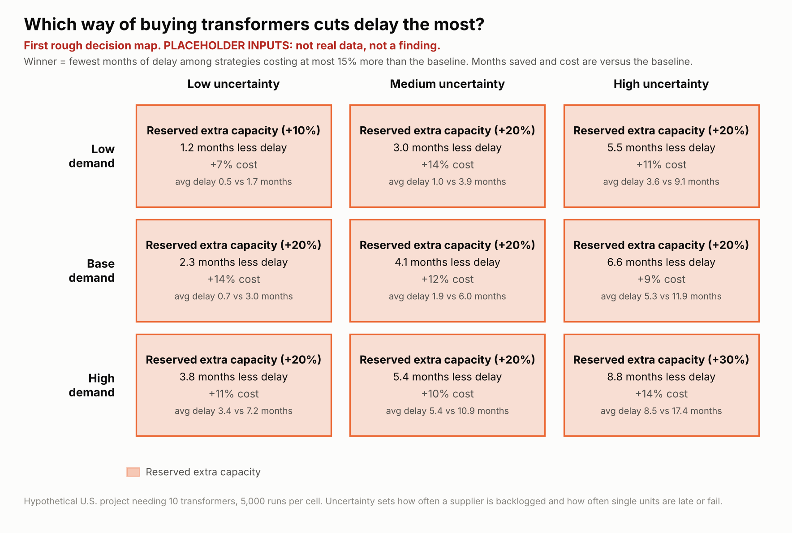
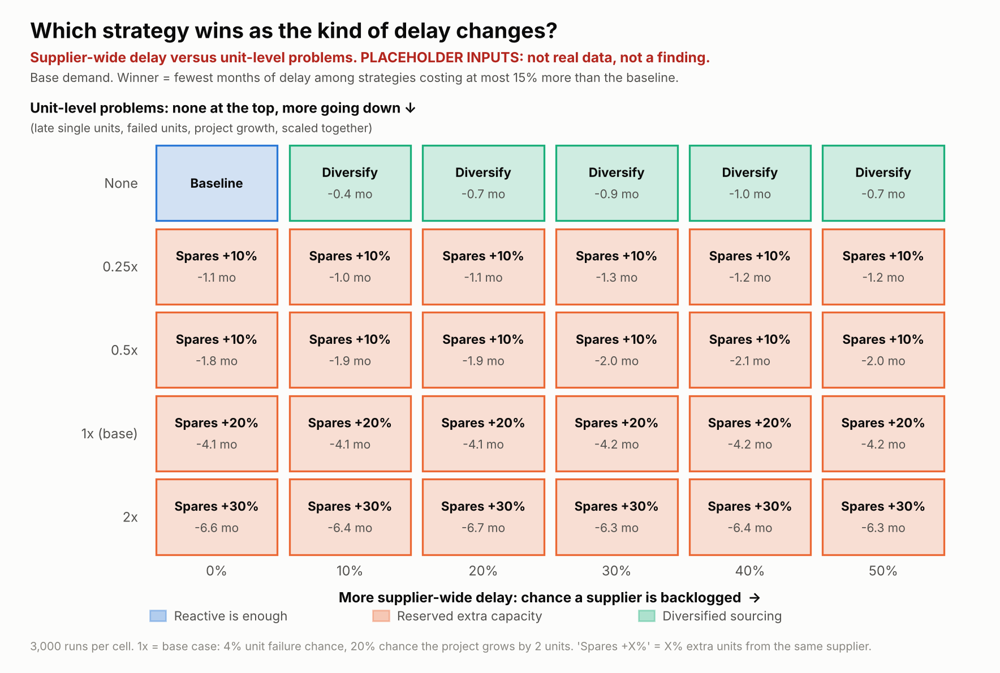

# Buy Smarter or Build Bigger? A Transformer Supply Study for U.S. AI Data Centers Through 2030

> **Status of results:** a first rough decision map already runs end to end (see below), but it uses **placeholder inputs**, so it shows how the model works, not a finding. The real headline result goes here at the week 5 checkpoint.

## Research question

For hypothetical U.S. AI data center projects through 2030, under which demand and supply conditions does smarter transformer procurement reduce delay more than simply reserving extra capacity?

## What this project produces

One **decision map**: three demand scenarios (low, base, high) by three levels of lead-time uncertainty (low, medium, high). Each cell shows which procurement strategy wins, how many months of delay it saves, and what it costs.

## Strategies compared

| Strategy | What the developer does |
| --- | --- |
| Reactive single source | Orders from one supplier when the project is approved (baseline) |
| Advance procurement | Orders earlier, before the project is fully approved |
| Diversified sourcing | Splits the order across two or more suppliers |
| Reserved extra capacity | Orders a fixed share of extra transformers (10%, 20%, or 30% above the base need) from one supplier at approval, held as spares |

**Fair comparison rule:** every strategy is scored on both delay and total cost. The map names a winner only among strategies that stay within a spending limit (a parameter chosen in week 1), so strategies are compared at similar cost.

### Why extra units help, and when they do not

More transformers do not automatically mean faster completion. If all 10 units from one supplier are stuck in the same six-month backlog, ordering 12 from that supplier just gives 12 late units. The model therefore separates three things:

| Problem | What happens | Which strategy helps |
| --- | --- | --- |
| **Supplier-wide delay** | A backlog hits every unit from one supplier at once | Diversified sourcing (re-source from a healthy supplier). Extra units do **not** help. |
| **Unit-level problems** | One unit arrives late or fails inspection while the others are fine | Reserved extra capacity (spares cover the gap) |
| **Demand increase** | The project turns out to need more units than planned | Reserved extra capacity (spares are already on hand) |

The key unknown is **how much of the delay is supplier-wide versus unit-level**. It is a documented range in `docs/assumptions.md`, and testing it is the first sensitivity analysis. Advance procurement is different: it does not remove any risk, it starts the clock earlier at a higher cost.

## First rough results (placeholder inputs, not findings)

Every number in the model is a placeholder until it is replaced with a documented range (see `docs/assumptions.md`). The pictures below prove the pipeline works and show what the final figures will look like.





Reading them: in this placeholder run, extra units never win when there are no unit-level problems at all, and diversified sourcing wins there whenever backlogs happen. Once unit-level problems exist, spares win. How strongly depends on placeholder numbers, which is why the real data audit comes next.

## Scope

In: electrical transformers for hypothetical U.S. AI data center projects.
Out (future work): cooling equipment, grid interconnection delays, projects outside the U.S.

## Data lake layers

| Layer | Folder | Contents |
| --- | --- | --- |
| Bronze | `data/bronze/` | Raw downloads, untouched, with the download date |
| Silver | `data/silver/` | Cleaned, standardized Parquet tables |
| Gold | `data/gold/` | Simulation inputs and results |

Data files are not committed. Every file is rebuilt by the scripts in `pipelines/`.

## How to run

Requires Python 3.10 or newer.

```bash
# 1. Create and activate a virtual environment
python -m venv .venv
source .venv/bin/activate          # Windows: .venv\Scripts\activate

# 2. Install the packages
pip install -r requirements.txt

# 3. Build the data lake
python pipelines/01_fetch_fred.py     # bronze: transformer price index from FRED
python pipelines/02_clean_fred.py     # silver: cleaned Parquet table

# 4. Run the simulation and draw the maps (placeholder inputs for now)
python simulation/sanity_checks.py    # checks the model behaves as designed
python simulation/run_simulation.py   # writes data/gold/ and results/*.csv
python simulation/decision_map.py     # draws results/*.png (try --budget 0.25)
```

More data pipeline steps (UN Comtrade, IEA, DOE) are added in weeks 2-3, and each replaces placeholders in `simulation/params.py`. See `simulation/README.md` for details.

## Documentation

- [`docs/research_proposal.md`](docs/research_proposal.md): the full research proposal
- [`docs/data_sources.md`](docs/data_sources.md): which datasets are verified and usable
- [`docs/assumptions.md`](docs/assumptions.md): every assumption in the model, with ranges, the delay and cost formulas, and the spending limit
- [`docs/next_steps.md`](docs/next_steps.md): the prioritized checklist for weeks 2-8

## Status

- [x] Repo skeleton
- [x] First end-to-end simulation and rough decision map (placeholder inputs)
- [x] Week 1: data source audit, definitions, spending limit, and assumptions (see `docs/`; numeric inputs are still placeholders)
- [ ] Weeks 2-3: bronze and silver layers, scenarios, lead-time ranges (replace placeholders)
- [ ] Weeks 4-5: real-input decision map (the headline result)
- [ ] Week 6: sensitivity analysis and 2022-2024 sanity check
- [ ] Weeks 7-8: write-up, README headline, optional dashboard

## Limitations

Public data cannot name every supplier or show contract delivery times, so lead times are ranges. The share of transformer demand caused by AI data centers is assumed and stated. Results show how strategies behave under stated scenarios; they are not forecasts of real projects.
